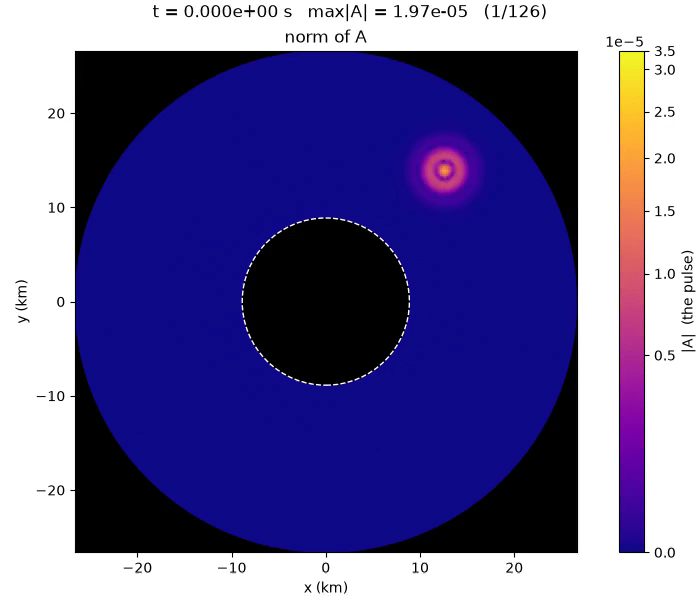

# rgsim: electromagnetic pulses in curved space

A small C++ library (`rgsim/`) and three example programs that evolve the vector potential `A_mu`
on a fixed curved 4D metric, using a reduced 5D (Kaluza-Klein-like) field equation. A pulse is sent through
the space and a Python script turns the result into an animation.

## The three programs

| Program | Space | Coordinates | Animation |
|---------|-------|-------------|-----------|
| `main_blackhole.cc` | Kerr-Newman black hole (optionally with its own electromagnetic field) | spherical (r, theta, phi) | `python/showBH.py` |
| `main_cartesian.cc` | flat space (Minkowski) in a box | Cartesian (x, y, z) | `python/showA.py` |
| `main_wormhole.cc` | Ellis wormhole, the pulse crosses the throat | spherical (r, theta, phi), r from -R to +R | `python/showWH.py` |

## Layout

| Path | Content |
|------|---------|
| `rgsim/` | the library (see below) |
| `example_metric.*` | metrics: Minkowski, Schwarzschild, Reissner-Nordstrom, Kerr, Kerr-Newman, Ellis wormhole (spherical and Cartesian versions) |
| `example_potential.*` | initial pulses (gaussian, wavepacket, soliton, chirp, ...) and the black hole's own field |
| `helpers.h` | small functions shared by the three programs (grid, initial state, time step, ...) |
| `main_*.cc` | the three programs |
| `python/` | the animation scripts |
| `rgsim/third_party/` | autodiff and Eigen (headers only) |

## The library

- **Functions of the coordinates** (`types.h`, `funcoperator.*`, `metricoperator.*`): a metric is a 4x4 table of
  `func`, i.e. functions of `(t, x1, x2, x3, x4)` written with `autodiff` dual numbers. `inverseMet` gives the
  inverse metric.
- **Differential geometry** (`Geodiff.*`): partial derivatives by automatic differentiation, Christoffel symbols,
  Ricci tensor and scalar.
- **Grid** (`field.*`): `Point`, `VectorPotential` (4 numbers `A_0..A_3`), `PointGrid`, `AGrid`.
- **Equation of motion** (`system.*`): `systemA` gives `d_t A` and `d_t V` (with `V = d_t A`) on the whole grid,
  with finite differences in space and boundary conditions per face (Dirichlet, Neumann, periodic, outgoing wave).
  `A_0` is not evolved.
- **Time stepping** (`systemsolver.*`): `rk4A` makes one Runge-Kutta 4 step on `(A, V)`.
- `einstein.*` (the 5D metric `g_hat`), `geodesic.*` (geodesics).

`field_solver.*` is the previous solver (state vector instead of grids). It is kept in the folder but is not part
of the build any more. `geodesic.cc` is not built either: it still calls an `rk4` for plain arrays that no
longer exists.

## Build and run

You need `g++` (C++17, OpenMP) and, for the animations, Python 3 with `numpy` and `matplotlib` (`ffmpeg` is
optional: without it a `.gif` is written instead of an `.mp4`).

```
make               # builds the three programs
make blackhole     # runs main_blackhole, then makes python/blackhole.mp4
make cartesian     # runs main_cartesian, then makes python/field.mp4
make wormhole      # runs main_wormhole,  then makes python/wormhole.mp4
make clean
```

Each program asks for its parameters (initial pulse, size of the grid, number of points, duration, ...).
It writes `python/dataforpy.dat`, `python/data/Field*.dat` and `python/data/Plane*.dat`, which the Python script reads.

Speed: `systemA` computes the metric data (inverse metric, Christoffel symbols, `h`, `box`) once per grid point
and keeps it, so the autodiff functions are not called again at every Runge-Kutta stage, and the loop over the
grid points runs in parallel (OpenMP). This assumes the metric does not depend on `t` (true for all the
examples). If yours does, set `metricIsStatic = false` (`rgsim/system.h`); call `resetMetricCache()` if you change the metric
or the grid. On one core, a grid of 150 000 points needs about 45 s for the one-time setup and then about 0.3 s per time step.

## The dilaton (new)

The old equation `systemA` is the coordinate component `R_{mu 5} = 0` of the 5D vacuum Einstein equations with the
scalars (`Phi`, `phihat`) **frozen**. Written in the KK frame, `R_{mu 5} = Phi (R_{(mu)(5)} + A_mu R_{(55)})`: the extra term
`A_mu * kA` (`kA = h^2/4 F^2 - Phi box`) is `A_mu R_{55}`. With a frozen scalar `R_{55} != 0`, and since `F^2 = 2(B^2 - E^2)` this
term is a *negative mass squared* wherever `E^2 > B^2`: exponential growth, then NaN. (Checked: switching only that term off removes the blow-up.)

`systemAphi` / `rk4Aphi` evolve a dynamical dilaton `phi` together with `A` (so `R_{55} = 0` holds and that term disappears):

    L = sqrt|g| [ 1/2 (d phi)^2 - 1/4 h e^{-a phi} F^2 ]      =>   nabla_mu(h e^{-a phi} F^{mu nu}) = 0 ,   box phi = (a/4) h e^{-a phi} F^2

`a = sqrt(3)` is the Kaluza-Klein value (5D vacuum Einstein -> 4D Einstein-Maxwell-dilaton). The energy
`Pi^2/2c^2 + |grad phi|^2/2 + e^{-a phi}(|d_t A|^2/c^2 + |B|^2)/2` is positive and conserved on a static background.
All three programs ask at the end "dilaton? (0/1)" and, if 1, the coupling `a`; old input files still work (no answer = old equation).
The Plane files get one more column (the dilaton) and the Python scripts show it as an extra panel.
Limits: the stability range is set by `a^2 A^2 / 4` (about `|A| <~ 3-4` for `a = sqrt(3)` on 64^3 points; the old equation failed
from `|A| ~ 3`); smaller `a` allows larger `A`. It also needs enough points across the pulse (>= ~6). `PC_AMP=<x> ./main_cartesian`
overrides the pulse amplitude (default 1e-5). `make test` runs the energy/stability test and the FLRW test.

## Time-dependent background (FLRW)

`flrw_cartesian` (flat de Sitter, `a = exp(H t)`, set `flrw_H`) with `metricIsStatic = false` and `metricIsHomogeneous = true`
(metric data evaluated once per call). `tests/test_flrw.cc` checks conformal invariance: a Maxwell pulse equals the flat-space one
at conformal time (0.13 % difference for a up to 2.7).

## Example: pulse around a Kerr-Newman black hole



## Credits

Claude (Anthropic) wrote the RK4 part (`rk4A`, `systemsolver.*`) and the system part (`systemA`, `system.*`) of the
program, and optimised both of them.
